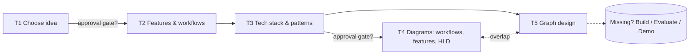

# Ticket Analysis Review: Generative AI Training Final Practice

This document reviews my analysis of Tickets 1–5, points out what was missed or wrongly assumed, and lists the clarifying questions to send to the ticket reporter.

---

## 1. Cross-ticket findings

These issues affect all five tickets, not only one.

| # | Finding | Type | Why it matters |
|---|---------|------|----------------|
| G1 | **No ticket has a deliverable or Definition of Done.** None of them says what the output is (a document, a diagram file, a slide), where it goes, or who approves it. | Missed | Without a DoD, no ticket can be closed objectively. |
| G2 | **The tickets are a strict chain, but there is no approval gate between them.** T1 → T2 → T3 → T4/T5. If the idea in T1 changes after T2 starts, everything after it is redone. | Missed | A reviewer sign-off after T1 (idea) and after T3 (stack) avoids rework. |
| G3 | **There is no implementation, evaluation, or demo ticket.** All five tickets are analysis and design. I assumed the final practice ends at design, but "practice what you have been trained for" suggests something gets built. | Possibly wrong assumption | This changes how deep T2–T5 must go. Design-only work can stay high-level. A build needs implementable detail. |
| G4 | **No constraints are stated**: timeline, team size (solo or group), budget for LLM API calls, allowed models or providers, allowed data. | Missed | These constraints filter the idea in T1 more than "difficulty" does. |
| G5 | **The ticket order is partly circular.** T5 (graph: nodes, edges, state) assumes a graph-based orchestration framework such as LangGraph, which is a tech-stack decision from T3. T4 "high-level design" and T5 "graph" also overlap. | Missed | T3 has to explicitly decide the orchestration approach, otherwise T5 has no basis. |

---

## 2. Per-ticket review

### Ticket 1: Come up with ideas for the final practice

**My first step:** Summarize the training knowledge, list project ideas, then choose one that is difficult enough and applies what I learned.

**Missed**
- **Selection criteria.** "Difficult enough" is subjective. A scoring rubric is needed. Proposed rubric (each scored 1–5):
  - Coverage of course topics (prompting, RAG, tool calling, agents, LangGraph, evaluation, guardrails, ...)
  - Feasibility within the timeline and team size
  - Data availability (public, synthetic, or internal, and whether it is allowed)
  - Evaluability (can output quality be measured?)
  - Cost (number of LLM calls per request, and the API budget)
  - Demo value (can it be shown end-to-end in a few minutes?)
- **A real user and problem.** Every idea should state *who* uses it and *what pain* it removes. Otherwise T2 has nothing to derive features from.
- **The course syllabus as input.** "Summarize the training knowledge" depends on having the official module list. Use that list as the source instead of memory, so the coverage score is verifiable.
- **Output format.** The result should be a shortlist (3–5 ideas), the scored rubric, and one recommended idea with its justification, ready for approval.

**Possibly wrong assumptions**
- *"Harder is better."* The final practice is usually judged on **applying the course correctly**, not on difficulty. A medium-sized idea that uses RAG + agent + evaluation well beats an ambitious one that is half finished.
- *"I choose alone."* The ticket says "choose the most suitable idea", but the reporter or mentor probably has to approve it (see Q2).

### Ticket 2: Analyze features and workflows

**My first step:** List the features, describe each one in detail, describe the flow of each feature, and synthesize them into one activity flow.

**Missed**
- **What features are based on.** This answers my own ambiguity: features come from **personas + user stories** for the problem chosen in T1, not from the technology.
- **A detail template.** For each feature, record:
  - User story: *As a … I want … so that …*
  - Inputs / outputs
  - Acceptance criteria (Given / When / Then)
  - Priority (MoSCoW: Must / Should / Could / Won't), which defines the MVP
  - GenAI-specific risks: hallucination, prompt injection, PII, latency, token cost
- **Non-functional requirements.** These include response time, cost per request, accuracy target, safety and guardrails, and observability. They drive T3 more than features do.
- **Unhappy paths in workflows.** These include LLM failure or timeout, low-confidence answers, retrieval with no results, human-in-the-loop review, and retries. A single happy-path flow hides exactly the parts that become graph edges in T5.
- **How the AI is evaluated.** For each AI feature, define how output quality is measured (a golden dataset, LLM-as-judge, or human rating).

**Possibly wrong assumption**
- *"One flow of activities is enough."* One end-to-end flow is useful as an overview, but workflows usually need two levels: the **overall user journey** and the **per-feature flow**, including error branches.

### Ticket 3: Analyze tech stack and patterns

**My first step:** List the technologies and patterns from the training, then research what is widely used in production.

**Missed**
- **Selection should be requirement-driven.** Map each choice to a requirement from T2, for example: "needs grounding on documents → RAG → vector DB". Researching what is popular in production without that filter risks scope creep.
- **A comparison method.** For each decision, compare 2–3 options against criteria (course coverage, team familiarity, cost, maturity, licensing) and record the result as a short **ADR** (Architecture Decision Record).
- **GenAI patterns to evaluate** (not only software patterns):
  - Prompt chaining, Router, Parallelization
  - RAG (naive, hybrid, re-ranking), Agentic RAG
  - ReAct / tool calling, Plan-and-Execute, Reflection / self-critique
  - Supervisor or hierarchical multi-agent
  - Human-in-the-loop, Guardrails (input and output)
  - Memory (short-term thread state vs long-term store)
- **LLMOps layer:** evaluation framework, tracing and observability (for example LangSmith or Langfuse), prompt versioning, and cost tracking.
- **Software patterns are still relevant**: layered or hexagonal architecture, repository, and dependency injection for swapping LLM providers.
- **Orchestration decision.** T3 must decide explicitly whether the agent uses a graph framework (for example LangGraph), because T5 depends on it.

**Possibly wrong assumption**
- *"I am free to choose the stack."* Trainings often mandate a language, framework, or LLM provider. Confirm before researching (see Q3).

### Ticket 4: Draw diagrams for workflows, high-level design, and features

**My first step:** Take the workflows, features, and tech stack from earlier tickets and list the diagrams that need to be drawn.

**Missed**
- **A diagram list with a notation per diagram.** Proposed list:

  | Diagram | Notation | Shows |
  |---------|----------|-------|
  | Use case diagram | UML use case | Actors and features (the "features" diagram) |
  | Workflow / activity diagram | Flowchart or UML activity, with swimlanes | User journey and per-feature flows, including error branches |
  | System context | C4 Level 1 | The system, its users, and external systems (LLM API, data sources) |
  | Container / high-level design | C4 Level 2 | Frontend, backend, agent service, vector DB, observability |
  | Key interactions | UML sequence | One request end-to-end (for example a RAG query with a tool call) |
  | Data / ingestion pipeline (if RAG) | Data flow diagram | Load → chunk → embed → store |

- **Tool choice** (answers "what to draw with quickly"). **Mermaid** is a strong default: it is text-based, versioned in git, and renders natively in GitLab Markdown. Use draw.io / Excalidraw / FigJam only for diagrams Mermaid handles poorly, such as complex C4 layouts.
- **Audience.** Diagrams for a mentor review can be high-level. Diagrams to implement from need more detail. The "easy to visualize" question depends on who reads them.

**Possibly wrong assumption**
- *"Features diagram" means drawing each feature.* It most likely means a **use case or feature map**, one diagram showing all features and actors, not one diagram per feature.

### Ticket 5: Analyze, design, and draw the graph

**My first step:** Analyze nodes, edges, and related states.

**Missed**
- **What "graph" means is assumed, not confirmed.** My analysis assumes a **LangGraph-style agent graph** (StateGraph). It could also mean a knowledge graph (GraphRAG) or simply a system dependency graph. This must be confirmed (see Q4).
- If it is an agent graph, "nodes, edges, state" is incomplete. A complete design also covers:
  - **State schema**: typed fields, which node reads or writes each field, and reducers for list or message fields
  - **Node catalogue**: responsibility, inputs, outputs, LLM vs deterministic, tools used
  - **Edges**: normal vs **conditional** edges, plus routing functions and their conditions
  - **Entry point and END conditions**
  - **Loops and termination**: max iterations / recursion limit, to prevent infinite agent loops
  - **Human-in-the-loop interrupts**: where the graph pauses for approval
  - **Persistence / checkpointing**: thread memory and resuming
  - **Error handling**: retry, fallback node, graceful failure
  - **Subgraphs**: if there are multiple agents, show the supervisor and sub-agent structure
- **Mapping to T2.** Each workflow branch in T2 (including unhappy paths) should become a node or conditional edge here. This is how the graph is derived "from an idea".
- **Verification.** If the graph is implemented, generate the diagram from code (for example LangGraph's `get_graph().draw_mermaid()`) and compare it with the designed diagram.

**Possibly wrong assumption**
- *"T5 is separate from T4."* The agent graph is part of the high-level design. Decide whether T4's HLD shows the graph as a single box ("Agent service") and T5 zooms in, to avoid drawing the same thing twice.

---

## 3. Proposed Definition of Done (to confirm with the reporter)

| Ticket | Deliverable | Done when |
|--------|-------------|-----------|
| T1 | `docs/01-idea-selection.md`: shortlist, scored rubric, recommended idea | Reporter approves the idea |
| T2 | `docs/02-features-workflows.md`: personas, user stories with AC, MoSCoW, NFRs, workflows | Every Must feature has acceptance criteria and a flow including error paths |
| T3 | `docs/03-tech-stack.md` + ADRs | Every choice is traced to a requirement, and the orchestration approach is decided |
| T4 | `docs/04-diagrams.md` (Mermaid) | Use case, workflow, C4 L1/L2, and sequence diagrams render in GitLab |
| T5 | `docs/05-graph-design.md` (Mermaid) | State schema, node catalogue, conditional edges, END/loop limits, and HITL points are defined |

---

## 4. Clarifying questions for the ticket reporter

> Hi, before I start on the final-practice tickets, I'd like to confirm a few points so I don't head in the wrong direction:
>
> 1. **Scope and deliverable:** Does the final practice end at analysis and design (Tickets 1–5), or is a working prototype also expected? If it should be built, what level is expected (demo or PoC vs production-grade with tests, evaluation, and deployment)? What is the deadline, and is this individual or team work?
>
> 2. **Idea selection:** What criteria will be used to judge the idea (for example coverage of specific modules such as RAG, agents, LangGraph, or evaluation; business value; complexity)? Do I need your approval on the idea before moving to Ticket 2? Can the idea use a real domain or internal data from our company, or should it use public or synthetic data only?
>
> 3. **Technical constraints:** Is there a mandated language, framework, or LLM provider, or am I free to choose? Is there a budget or API key provided for LLM usage?
>
> 4. **Meaning of "graph" in Ticket 5:** Do you mean the agent orchestration graph (for example a LangGraph StateGraph with nodes, edges, and state), a knowledge graph, or something else? How should it differ from the high-level design diagram in Ticket 4?
>
> 5. **Format and review:** Is there a template or expected format for the deliverables (for example Markdown in the GitLab repo with Mermaid diagrams, or Confluence / draw.io / slides)? Who reviews each ticket, and is there a review checkpoint between tickets?
