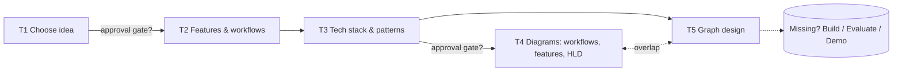

# Ticket Analysis Review: Generative AI Training Final Practice

This document reviews my analysis of Tickets 1–5. Each ticket starts with the 3-sentence analysis (what it asks, what's ambiguous, first step): my original version, then a revised version after the review. The details below explain what was missed or wrongly assumed, and section 4 lists the clarifying questions for the ticket reporter.

---

## 1. Cross-ticket findings

These issues affect all five tickets, not only one.

| # | Finding | Type | Why it matters |
| --- | --- | --- | --- |
| G1 | **No ticket has a deliverable or Definition of Done.** None of them says what the output is (a document, a diagram file, a slide), where it goes, or who approves it. | Missed | Without a DoD, no ticket can be closed objectively. |
| G2 | **The tickets are a strict chain, but there is no approval gate between them.** T1 → T2 → T3 → T4/T5. If the idea in T1 changes after T2 starts, everything after it is redone. | Missed | A reviewer sign-off after T1 (idea) and after T3 (stack) avoids rework. |
| G3 | **There is no implementation, evaluation, or demo ticket.** All five tickets are analysis and design. I assumed the final practice ends at design, but "practice what you have been trained for" suggests something gets built. | Possibly wrong assumption | This changes how deep T2–T5 must go. Design-only work can stay high-level. A build needs implementable detail. |
| G4 | **No constraints are stated**: timeline, team size (solo or group), budget for LLM API calls, allowed models or providers, allowed data. | Missed | These constraints filter the idea in T1 more than "difficulty" does. |
| G5 | **The ticket order is partly circular.** T5 (graph: nodes, edges, state) assumes a graph-based orchestration framework such as LangGraph, which is a tech-stack decision from T3. T4 "high-level design" and T5 "graph" also overlap. | Missed | T3 has to explicitly decide the orchestration approach, otherwise T5 has no basis. |

---

## 2. Per-ticket review

### Ticket 1: Come up with ideas for the final practice

#### Original analysis

1. **What it asks:** Choose the most suitable idea to end the Generative AI training course.
2. **What's ambiguous:** What idea is suitable? What are your ideas for being able to practice what you have been trained for? Should a project be built as a production project?
3. **First step:** Summarize the training knowledge, list the projects you have thought of, choose a project that is difficult enough and apply the knowledge you have learned.

#### Revised analysis (after review)

1. **What it asks:** Choose one final-practice project idea that applies the course content, and get it approved.
2. **What's ambiguous:** The criteria for "suitable", whether the project must be built (and to what level), and the constraints (deadline, team, stack, data).
3. **First step:** Confirm the expected deliverable and constraints with the reporter, then shortlist 3–5 ideas from the course syllabus and score them against a rubric.

#### Missed

- **Selection criteria.** "Difficult enough" is subjective. A scoring rubric is needed. Proposed rubric (each scored 1–5):
  - Coverage of course topics (prompting, RAG, tool calling, agents, LangGraph, evaluation, guardrails, ...)
  - Feasibility within the timeline and team size
  - Data availability (public, synthetic, or internal, and whether it is allowed)
  - Evaluability (can output quality be measured?)
  - Cost (number of LLM calls per request, and the API budget)
  - Demo value (can it be shown end-to-end in a few minutes?)
- **A real user and problem.** Every idea should state *who* uses it and *what pain* it removes. Otherwise T2 has nothing to derive features from.
- **The course syllabus as input.** "Summarize the training knowledge" depends on having the official module list. Use that list as the source instead of memory, so the coverage score is verifiable.
- **Output format.** The result should be a shortlist (3–5 ideas), the scored rubric, and one recommended idea with its justification, ready for approval.

#### Possibly wrong assumptions

- *"Harder is better."* The final practice is usually judged on **applying the course correctly**, not on difficulty. A medium-sized idea that uses RAG + agent + evaluation well beats an ambitious one that is half finished.
- *"I choose alone."* The ticket says "choose the most suitable idea", but the reporter or mentor probably has to approve it (reserve question in the role-play doc).

### Ticket 2: Analyze features and workflows

#### Original analysis

1. **What it asks:** Analyze the selected idea and list and detail the features and workflows included in the project.
2. **What's ambiguous:** How should I list and detail them? What are those features and workflows based on?
3. **First step:** List the features first, in each feature describe in detail what it does. Then, further describe the flow of each feature and synthesize it into one flow of activities for the project.

#### Revised analysis (after review)

1. **What it asks:** For the chosen idea, define the features (who uses them and what they do) and the workflows that connect them end to end.
2. **What's ambiguous:** The format and level of detail, and whether error paths and non-functional requirements (speed, cost, safety, accuracy) are in scope.
3. **First step:** Define the users and their problem, write user stories with acceptance criteria and priorities, then draw each feature's flow including error paths.

#### Missed

- **What features are based on.** This answers my own ambiguity: features come from **personas + user stories** for the problem chosen in T1, not from the technology.
- **A detail template.** For each feature, record:
  - User story: *As a … I want … so that …*
  - Inputs / outputs
  - Acceptance criteria (Given / When / Then)
  - Priority (MoSCoW: Must / Should / Could / Won't), which defines the MVP
  - GenAI-specific risks: hallucination, prompt injection, PII, latency, token cost
- **Non-functional requirements.** These include response time, cost per request, accuracy target, safety and guardrails, and observability. They drive T3 more than features do.
- **Unhappy paths in workflows.** These include LLM failure or timeout, low-confidence answers, retrieval with no results, human-in-the-loop review, and retries. A single happy-path flow hides exactly the parts that become graph edges in T5.
- **How the AI is evaluated.** For each AI feature, define how output quality is measured (a golden dataset, LLM-as-judge, or human rating).

#### Possibly wrong assumption

- *"One flow of activities is enough."* One end-to-end flow is useful as an overview, but workflows usually need two levels: the **overall user journey** and the **per-feature flow**, including error branches.

### Ticket 3: Analyze tech stack and patterns

#### Original analysis

1. **What it asks:** Analyze and select technologies to build the project, and select appropriate patterns to apply to the project.
2. **What's ambiguous:** How to choose the technology stack? How to choose suitable patterns?
3. **First step:** List the technologies and patterns that have been learned during training, and research the technologies and patterns that are widely applied to production projects.

#### Revised analysis (after review)

1. **What it asks:** Choose the technologies and patterns that meet the requirements from Ticket 2.
2. **What's ambiguous:** Whether any part of the stack is mandated, what criteria to compare options by, and whether the orchestration approach (needed by Ticket 5) is decided here.
3. **First step:** Confirm which parts of the stack are fixed, then map each Ticket 2 requirement to candidate technologies and patterns and compare 2–3 options per decision.

#### Missed

- **Selection should be requirement-driven.** Map each choice to a requirement from T2, for example: "needs grounding on documents → RAG → vector DB". Researching what is popular in production without that filter risks scope creep.
- **A comparison method.** For each decision, compare 2–3 options against criteria (course coverage, team familiarity, cost, maturity, licensing) and record the result as a short **ADR** (Architecture Decision Record).
- **GenAI patterns to evaluate** (not only software patterns):
  - Prompt chaining, Router, Parallelization
  - RAG (naive, hybrid, re-ranking), Agentic RAG
  - ReAct / tool calling, Plan-and-Execute, Reflection / self-critique
  - Supervisor or hierarchical multi-agent
  - Human-in-the-loop, Guardrails (input and output)
  - Memory (short-term thread state vs long-term store)
- **LLMOps layer:** evaluation framework, tracing and observability (for example LangSmith or Langfuse), prompt versioning, and cost tracking.
- **Software patterns are still relevant**: layered or hexagonal architecture, repository, and dependency injection for swapping LLM providers.
- **Orchestration decision.** T3 must decide explicitly whether the agent uses a graph framework (for example LangGraph), because T5 depends on it.

#### Possibly wrong assumption

- *"I am free to choose the stack."* Trainings often mandate a language, framework, or LLM provider. Confirm before researching (see Q3).

### Ticket 4: Draw diagrams for workflows, high-level design, and features

#### Original analysis

1. **What it asks:** Draw diagrams for the workflows, features, and high-level design included in the project.
2. **What's ambiguous:** How to draw so that it is easy to visualize and understand? What do you use to draw quickly and conveniently?
3. **First step:** Get the workflows, features and technical stack that have been analyzed in the previous task to list the diagrams that need to be drawn.

#### Revised analysis (after review)

1. **What it asks:** Draw the workflow, feature, and high-level design diagrams for the project.
2. **What's ambiguous:** Which diagram types and notation to use, who the audience is, which tool to use, and how this overlaps with the Ticket 5 graph.
3. **First step:** From the Ticket 2 and 3 outputs, list the diagrams needed (use case, activity, C4 levels 1–2, sequence) and draw them in Mermaid.

#### Missed

- **A diagram list with a notation per diagram.** Proposed list:

  | Diagram | Notation | Shows |
  | --- | --- | --- |
  | Use case diagram | UML use case | Actors and features (the "features" diagram) |
  | Workflow / activity diagram | Flowchart or UML activity, with swimlanes | User journey and per-feature flows, including error branches |
  | System context | C4 Level 1 | The system, its users, and external systems (LLM API, data sources) |
  | Container / high-level design | C4 Level 2 | Frontend, backend, agent service, vector DB, observability |
  | Key interactions | UML sequence | One request end-to-end (for example a RAG query with a tool call) |
  | Data / ingestion pipeline (if RAG) | Data flow diagram | Load → chunk → embed → store |

- **Tool choice** (answers "what to draw with quickly"). **Mermaid** is a strong default: it is text-based, versioned in git, and renders natively in GitLab Markdown. Use draw.io / Excalidraw / FigJam only for diagrams Mermaid handles poorly, such as complex C4 layouts.
- **Audience.** Diagrams for a mentor review can be high-level. Diagrams to implement from need more detail. The "easy to visualize" question depends on who reads them.

#### Possibly wrong assumption

- *"Features diagram" means drawing each feature.* It most likely means a **use case or feature map**, one diagram showing all features and actors, not one diagram per feature.

### Ticket 5: Analyze, design, and draw the graph

#### Original analysis

1. **What it asks:** Analyze and draw a diagram of the complete graph of the project.
2. **What's ambiguous:** How to complete a graph diagram from an idea?
3. **First step:** Analyze nodes, edges and related states.

#### Revised analysis (after review)

1. **What it asks:** Design and draw the complete graph of the project.
2. **What's ambiguous:** What "graph" means (agent flow or knowledge graph), what "complete" must include, and how it differs from the Ticket 4 diagrams.
3. **First step:** Confirm what "graph" means; if it is the agent flow, derive the state, nodes, and conditional edges from the Ticket 2 workflows.

#### Missed

- **What "graph" means is assumed, not confirmed.** My analysis assumes a **LangGraph-style agent graph** (StateGraph). It could also mean a knowledge graph (GraphRAG) or simply a system dependency graph. This must be confirmed (see Q4).
- If it is an agent graph, "nodes, edges, state" is incomplete. A complete design also covers:
  - **State schema**: typed fields, which node reads or writes each field, and reducers for list or message fields
  - **Node catalogue**: responsibility, inputs, outputs, LLM vs deterministic, tools used
  - **Edges**: normal vs **conditional** edges, plus routing functions and their conditions
  - **Entry point and END conditions**
  - **Loops and termination**: max iterations / recursion limit, to prevent infinite agent loops
  - **Human-in-the-loop interrupts**: where the graph pauses for approval
  - **Persistence / checkpointing**: thread memory and resuming
  - **Error handling**: retry, fallback node, graceful failure
  - **Subgraphs**: if there are multiple agents, show the supervisor and sub-agent structure
- **Mapping to T2.** Each workflow branch in T2 (including unhappy paths) should become a node or conditional edge here. This is how the graph is derived "from an idea".
- **Verification.** If the graph is implemented, generate the diagram from code (for example LangGraph's `get_graph().draw_mermaid()`) and compare it with the designed diagram.

#### Possibly wrong assumption

- *"T5 is separate from T4."* The agent graph is part of the high-level design. Decide whether T4's HLD shows the graph as a single box ("Agent service") and T5 zooms in, to avoid drawing the same thing twice.

---

## 3. Proposed Definition of Done (to confirm with the reporter)

| Ticket | Deliverable | Done when |
| --- | --- | --- |
| T1 | `docs/01-idea-selection.md`: shortlist, scored rubric, recommended idea | Reporter approves the idea |
| T2 | `docs/02-features-workflows.md`: personas, user stories with AC, MoSCoW, NFRs, workflows | Every Must feature has acceptance criteria and a flow including error paths |
| T3 | `docs/03-tech-stack.md` + ADRs | Every choice is traced to a requirement, and the orchestration approach is decided |
| T4 | `docs/04-diagrams.md` (Mermaid) | Use case, workflow, C4 L1/L2, and sequence diagrams render in GitLab |
| T5 | `docs/05-graph-design.md` (Mermaid) | State schema, node catalogue, conditional edges, END/loop limits, and HITL points are defined |

---

## 4. Clarifying questions for the ticket reporter

Each question asks one thing. The same set is used in [reporter-questions-roleplay.md](reporter-questions-roleplay.md).

> Hi, before I start on the final-practice tickets, I'd like to confirm a few points:
>
> 1. At the end of the course, what do you expect to see: only design documents, a working demo, or a deployed product?
> 2. When is the final practice due?
> 3. Which parts of the stack are fixed: the course topics to use (for example RAG, agents, LangGraph), the language, the LLM provider, or none?
> 4. In Ticket 5, does "graph" mean the agent flow (nodes, edges, state), a knowledge graph, or something else?
> 5. Is there a sample from a previous batch, or a template, that I can follow for the format?
